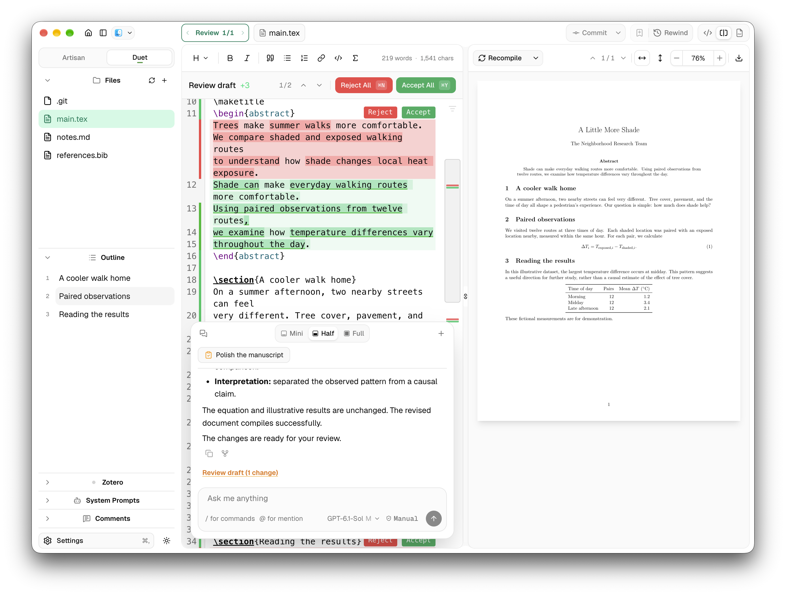

<p align="center"></p>

<h1 align="center">Catalex</h1>

<p align="center"><strong>A catalyst for your next paper.</strong><br />An open-source, local-first LaTeX workspace with agent assistance.</p>

<p align="center"></p>

<p align="center"><a href="https://github.com/Catalex-app/Catalex/releases"></a> <a href="https://catalex-app.github.io/"></a></p>



## “Catalex is damaged and can’t be opened”?

The current beta is not yet signed with an Apple Developer ID or notarized, so macOS may block it on first launch. If you encounterd "“Catalex is damaged and can’t be opened”, run this command in Terminal (only need to do it once):

```sh
xattr -dr com.apple.quarantine /Applications/Catalex.app
```

This applies only to Catalex and does not disable Gatekeeper system-wide.

You can also [build Catalex from source](docs/development/setup.md). 

## Why Catalex?

- **Built for writing.** A clean, polished workspace that keeps writing in focus and makes working with agents feel natural.
- **Bring your own agent.** Use local Claude Code, Codex, or Pi with your existing subscriptions and skills, connected to your project and Catalex's writing tools.
- **Draft first, approve later.** Agents prepare changes in a private draft; you choose what to apply.

| | Catalex | OpenAI Prism | ClaudePrism | IDE + extensions |
| --- | :---: | :---: | :---: | :---: |
| Dedicated writing app | ✓ | ✓ | ✓ | |
| Local files and compilation | ✓ | | ✓ | ✓ |
| LaTeXmk support | ✓ | — | | ✓ |
| Switch agent providers in one chat | ✓ | | | |
| Built-in agent worktrees | ✓ | | | ✓ |
| Agents can create and resolve comments | ✓ | | | |
| Edit history and recovery | ✓ | ✓ | ✓ | ✓ |
| Overleaf / GitHub sync through the app's Git GUI | ✓ | | | ✓ |
| Live co-editing | | ✓ | | |

## Documentation

See the [user guide](docs/README.md) for setup, writing, agents, and syncing your project.

## Current limitations

- **macOS only.** Current releases support Apple Silicon Macs.
- **Comments stay local.** Catalex comments do not sync to Overleaf or GitHub.
- **No live collaboration.** Catalex is local-first. Collaborators can sync project files through GitHub, but shared multi-user editing is not supported.

## License

Catalex is licensed under the [GNU AGPLv3 or later](LICENSE). See [NOTICE](NOTICE) for the MIT-licensed Claude bridge, upstream notices, and third-party terms.

## Acknowledgments

Catalex started from [ClaudePrism](https://github.com/delibae/claude-prism), which builds on [Open Prism](https://github.com/assistant-ui/open-prism). Its writing workflow takes inspiration from [OpenAI Prism](https://openai.com/index/introducing-prism/), [Overleaf](https://www.overleaf.com/), and [LaTeX Workshop](https://github.com/James-Yu/LaTeX-Workshop).

Catalex is created and directed by [@RicercarG](https://github.com/RicercarG), with [@openai](https://github.com/openai)'s [Codex](https://github.com/openai/codex) assisting in implementation, and debugging. Special thanks to Codex for helping bring these ideas to life.

Thanks to [@JunhaoZhu0220](https://github.com/JunhaoZhu0220) and [@Akutagawa1998](https://github.com/Akutagawa1998) for testing Catalex before its public release, sharing thoughtful feedback, and helping track down bugs.

The icon was drawn in Figma by [@RicercarG](https://github.com/RicercarG), inspired by the [reference illustration](assets/icon-source/assets/cat-reference.png) below.


Cheers!
